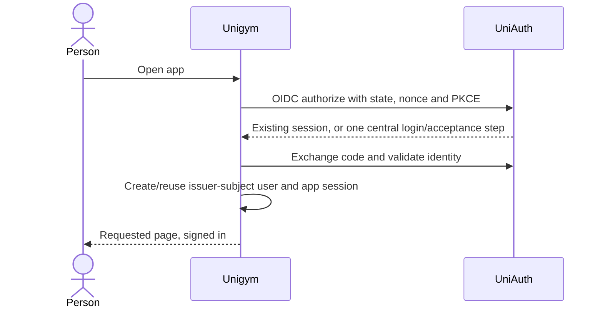

# UniAuth sign-in on the Go API

Status: Aligning — deferred by the user on 2026-10-21; spec only.
Tracker: UA-4 on the UniAuth board.

## Scope

Restore authentication against the current Go/Gin API when separately authorized.
Opening Unigym with an existing UniAuth browser session should sign the person in
without another password or app-specific terms prompt. Keep a host-only Unigym
session, bind users by issuer and subject, and consume actual shared acceptance.
Do not restore the removed NestJS implementation or share cookies between apps.

UniAuth, Unishare and Uniloom implementation continues separately. Adding Unigym
to their shared policy bundle must be deliberate and versioned; do not silently
extend previously recorded acceptance to a new app.

## Done when

- [ ] OIDC authorization-code sign-in validates state, PKCE, nonce, signatures,
      issuer, audience and expiry, then creates a local session for the linked user.
- [ ] Existing UniAuth sessions open Unigym signed in; missing shared acceptance
      goes to UniAuth once, and signed-out/expired sessions never cause a redirect loop.
- [ ] Account/session storage preserves identity-link uniqueness and shared policy
      evidence. Suspended or deleted identities cannot use protected routes.
- [ ] Sign-out and verified back-channel logout/identity events invalidate the
      correct sessions and tolerate duplicate or stale deliveries.
- [ ] Go and browser tests cover first visit, return visit, callback replay,
      forged tokens, expired state, policy changes, logout and suspension.

## Design

| Boundary      | Location                                                | Intended implementation                                                                                                                                                                            |
| ------------- | ------------------------------------------------------- | -------------------------------------------------------------------------------------------------------------------------------------------------------------------------------------------------- |
| Auth settings | `apps/api/internal/config`                              | Validate issuer, web origin, client credentials and event audiences. Permit local HTTP only for development.                                                                                       |
| OIDC flow     | New `apps/api/internal/auth`                            | Use a maintained OIDC verifier rather than handwritten JWT validation. Use `telemetry.HTTPClient`, bounded timeouts and safe return paths. Choose and pin dependencies when implementation starts. |
| Auth storage  | New goose migration, `queries/auth.sql`, generated sqlc | Store expiring browser-bound login transactions, issuer/subject user links and hashed app-session tokens. Consume callbacks once. Never overwrite existing migration history.                      |
| HTTP routes   | `apps/api/internal/server/server.go`                    | Mount sign-in, callback, session/profile, same-origin POST sign-out and signed event receivers under `/api`. Keep health public.                                                                   |
| Browser entry | `apps/web/src/components/auth` and App Router pages     | Bounded silent sign-in on visits, explicit recovery on errors, shared acceptance through UniAuth. Preserve the return page.                                                                        |
| Deployment    | Environment example, chart and UniAuth registry         | Configure the web-origin callback and API-origin receivers. Deploy central shared-policy support before the consumer.                                                                              |

## Edge cases and rollout

Retain email verification and app authorization. An invite or provisioned user
never creates a browser session or accepts terms. Reject mismatched state/nonce,
invalid audiences, untrusted return URLs and stale policy evidence. Verify signed
events before changing records, deduplicate event IDs and preserve version order.
Keep third-party OAuth consent separate from first-party shared acceptance.

Use disposable staging accounts and databases for integration tests. Production
account changes and deployment require their own authorization.

## Changes

The user deferred implementation. Initial dependency and SQL drafts were removed;
this worktree contains planning only. No migration or deployment was applied to
Unigym, and no production accounts were changed.
